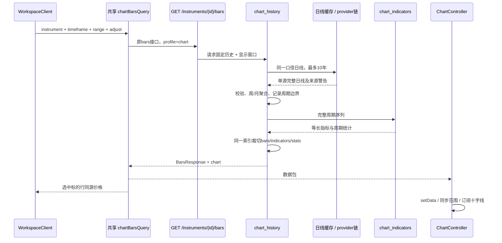

# 专业 K 线工作台设计与实施计划

> 实施工程师：按本文任务顺序逐项实施；可使用
> `superpowers:executing-plans` 跟踪执行。本节点只产出规格，不实施源码。

**版本：** v2（方案评审与修复）

**日期：** 2026-11-20

**功能标识：** `professional-kline-workbench`

**目标：** 将标的详情页左侧行情面板升级为支持完整行情读数、典型技术指标、
同步副图和专业视图操作的 K 线工作台。

**架构：** 后端生成统一的行情及指标数据包，前端保留现有动态加载边界，
以多个 lightweight-charts 实例共享时间索引；报告与行情仍按现有 URL 联动。

**技术栈：** Next.js 15、React 19、TypeScript、TanStack Query、Zustand、
lightweight-charts 4.2.3、FastAPI、Pydantic、SQLAlchemy、SQLite。

## 评审记录

2026-11-20 对 v1 逐节核对可行性、完整性、项目一致性与范围。
证据来自当前工作区源码、本地 4.2.3 类型声明及第12节官方文档。
本表记录的是设计缺陷及正文修订，不表示对应代码已经实现或测试通过。
共发现 **12项 P1、4项 P2，无 P0**；全部已在本文修订关闭。

| 编号 | 级别 | 问题与代码证据 | 正文修复位置与验收 | 状态 |
| --- | --- | --- | --- | --- |
| R-01 | P1 | §5.2未规定写前校验，现有路由直接write/commit，坏数据可污染共享缓存；cache.write_bars同源为upsert，还会留下已撤回的旧柱 | §5.2写前验证、事务替换请求范围、聚合后有限性及按交易日唯一校验；AC-30 | 已修复 |
| R-02 | P1 | §5.2无条件删除首个周/月桶，新上市且只有一桶时图表变空；历史不足计数也未定义 | §5.2保留显示桶、仅排除与计算边界相交的首桶参与计算；§6.1增加leadingPartial/warmupBarsCount；AC-31 | 已修复 |
| R-03 | P1 | §2声称不改报告快照，但§7.2直接改共用rsi，snapshot_technicals和standard随之变值；追加schema也改变standard JSON字段集合 | §6.1明确增量兼容，§7.2隔离图表RSI，§8–9冻结共用算法；AC-29 | 已修复 |
| R-04 | P1 | AppShell有两个条件挂载的PricePanel；§4.7未指定扩展/断点切换时唯一图表和临时状态的稳定所有者 | §4.7、§5.4、§6.2改为单一PricePanel拥有者、portal承载点与内存ref；AC-32 | 已修复 |
| R-05 | P1 | CandleChart对chartFocus和bars变化重放定位；仅切标的清理不足以防扩展恢复和同参数刷新再次跳视区 | §5.4在稳定宿主接收并消费一次focus；AC-33 | 已修复 |
| R-06 | P1 | §4.2立即处理无time会在跨窗时闪回，且pointerleave会覆盖移动端固定读数；同步事件与真离开未区分 | §4.2、§4.6、§5.3定义来源优先级、跨窗延后清理、触摸点击判定；AC-11/34 | 已修复 |
| R-07 | P1 | 读数采用交易日但canvas时间轴仍按UTC日期格式化；§6.2也未校验日期区间及标的/口径对应关系 | §5.3统一轴标签日期，§6.2验证日期、单位、数组与请求身份；AC-35 | 已修复 |
| R-08 | P1 | 微价仅改变DOM精度，库默认priceFormat仍为2位；多线副图和全null窗的纵轴范围未完整规定 | §4.2、§5.3规定series精度、范围合并及全null状态；AC-36 | 已修复 |
| R-09 | P1 | §5.4只按index保存读数/视区；同参数刷新增删历史后，index可能对应另一交易日，测量也可能显示旧总量 | §5.4以ts锚定视区/选择并重新校验、清理测量；AC-37 | 已修复 |
| R-10 | P1 | §4.5会截获Ctrl/Cmd加减及0；全局useHotkeys和Radix同样消费Escape，输入框日期也可能触发整窗关闭 | §4.5、§4.7明确修饰键、IME及Escape逐层消费；AC-38 | 已修复 |
| R-11 | P1 | §6.1未界定新旧契约的前端类型、发布顺序与回滚；仅chart=null提示不足以防未知版本被当成旧服务 | §6.1–6.2与§9补兼容分支及发布/回滚步骤；AC-39 | 已修复 |
| R-12 | P1 | §4.2要求头部始终为尾柱，却没有空数据/错误/兼容分支；useRailQuotes仍可能保留上个口径数值或用quote涨幅配图表价格 | §4.2、§5.1、§6.2统一价格对和错误降级；AC-40 | 已修复 |
| R-13 | P2 | §4.7要求清除光标后截图，但4.2 takeScreenshot原本排除crosshair；导出期间换数据/卸载没有一致性边界 | §4.7固定导出快照、保留交互光标并取消失效任务；AC-26 | 已修复 |
| R-14 | P2 | CSV称包含全部统计但未列全日期、基准、预热和算法元数据；PNG未明确未绘制的DOM工具覆盖层 | §4.7、§6.1枚举导出列与截图边界；AC-26 | 已修复 |
| R-15 | P2 | chartBarsQuery默认焦点/重连刷新会重复请求十年历史，且扩展开关若重挂查询会增加请求 | §5.1禁用焦点/重连刷新，稳定宿主持有查询；§11保留首次取数成本说明 | 已修复 |
| R-16 | P2 | §13仍要求下一节点修v2、只回填Subtask #0；评审定位与验证责任容易被误用 | §13区分前置记录、本节点及实施验证；§10增加AC-29至40 | 已修复 |

逐节复核：§1–3范围和架构可保留；§4修订状态、键盘、宿主与导出；
§5修订取数事务、时间同步和刷新状态；§6–7修订兼容契约及RSI隔离；
§8–10同步文件边界、实施顺序和验收；§11–14更新风险、参考与调度责任。
未引入分钟行情、交易执行、全站缓存重构、升级图表库或新增依赖。

## 1. 概述

用户打开一个标的后，需要在左侧图表完成行情观察，而不是只能看蜡烛和几条均线。
本次交付覆盖行情读数、主图指标、独立成交量及振荡指标副图、缩放与定位、
图表扩展视图、区间测量、文本替代和导出。鼠标悬停任何一根日 K 线时，
界面应即时显示该交易日的开高低收、相邻收盘价涨跌额和涨跌幅、振幅、成交量、
成交额，以及当前启用的指标值；周/月线则清楚标为该周期的读数。

已有投研报告、来源抽屉、行情与报告的日期联动、合成行情提示必须继续工作。
专业性首先来自数据口径明确、交互稳定和信息可读，因此本期统一使用后端指标，
明确预热区间和空值语义，让图表副图、悬停读数、文本表格与下载使用同一数据包。
成交量不再挤压到价格坐标里；MACD、RSI、KDJ 和 ATR 可切换查看，
指标参数和算法约定可以直接从界面查阅。

本期保留日/周/月线，不引入分时和分钟行情，不建立 WebSocket 推送、交易下单、
告警或任意公式编辑器。普通拖拽仍然平移，报告区间框选有明确工具入口。
设置在当前浏览器持久化，游客可以使用全部只读图表功能，不消耗 AI 额度。

## 2. 代码核对与边界

已阅读 `README.md`、`CLAUDE.md`、`.claude-index/index.md`、
`api/README.md`，并核对下列实际代码。行号会随实施改变，以下以导出名称定位。

| 现有路径 / 入口 | 实测现状 | 本次设计依据 |
| --- | --- | --- |
| `web/components/chart/PricePanel.tsx` | 日/周/月、五档区间、复权、MA/BOLL/VOL 开关；没有悬停读数 | 保留受控 `chartView`，重排工具栏与读数区 |
| `web/components/chart/CandleChart.tsx` | 单实例蜡烛、覆盖式成交量、MA、BOLL 上下轨；没有 crosshair 订阅 | 拆出同步控制器、独立副图和悬停回调 |
| `web/components/chart/IndicatorToggles.tsx` | `aragon.indicators.v1` 存储六项布尔开关 | 单向迁移至版本化图表设置 |
| `web/components/chart/useBrushRange.ts` | 250 ms 防抖及代号失效；用于报告反查 | 保留查询实现，扩展图表输入方式 |
| `api/app/services/indicators.py` | 有 SMA、EMA、BOLL、MACD、RSI、ATR；bundle 未返回 MACD 柱、BOLL 中轨、KDJ | 新增图表专用 bundle，复用纯计算函数 |
| `api/app/routers/instruments.py::bars` | 读日线缓存后重采样；先裁窗口再计算指标 | 图表专用 profile 先预热、计算，再统一裁切 |
| `api/app/services/market_data/base.py::resample_daily` | 周/月来自日线；末根 ts、收盘取组内最后一天 | 延续同一日线源的聚合，不向 provider 请求周/月 |
| `web/lib/useRailQuotes.ts` | 选中行与 PricePanel 共用 bars query key | 必须同时迁移，防止价格口径分叉和重复请求 |
| `web/components/shell/AppShell.tsx` | 桌面面板与小屏抽屉分别挂载 PricePanel | 两个入口接入相同配置和框选参数 |
| `web/components/shell/WorkspaceClient.tsx` | 拥有 `tf/win/adj`、报告 `range` 和 chartView | 不在 PricePanel 另建 URL 真源 |
| `web/lib/layout.ts` | 1280 以下行情进入抽屉，960 以下标的栏收起 | 保留断点和三栏比例 |
| `web/node_modules/lightweight-charts/package.json` | 当前实际安装 4.2.3 | 禁止采用 v5 的 `addSeries` 或原生 pane API |

现有待提交改动包括 `api/app/security/deps.py`、`policy.py`、
`CLAUDE.md`、`.claude-index/` 和其他功能文档。本功能实施不得覆盖或提交这些既有工作。

遵守三条项目不变量：API 单 worker、表结构只由 Alembic 管理、
Pydantic 后端契约先于前端镜像。本期不改变表结构，不增加迁移，
不修改报告快照和生成协议，不增加 npm 或 Python 依赖。

## 3. 方案选择与范围

### 3.1 方案比较

| 方案 | 收益 | 代价 | 决策 |
| --- | --- | --- | --- |
| 保留 4.2.3，用多个实例同步主副图 | 保留现有集成与体积，API 已在安装包中核验 | 要显式处理坐标、订阅和销毁 | 采用 |
| 升级 lightweight-charts 5.x 并重做原生 pane | 未来维护副图更直接 | 引入版本迁移、已有交互及打包回归 | 本期不采用 |
| 整体换为嵌入式行情终端或 ECharts K 线 | 可获得另一套图表能力 | 改变数据及 UI 边界，迁移报告联动 | 本期不采用 |

这是基于本仓库集成成本的工程选择。4.2 的 crosshair 和 logical range 接口
已对照官方文档及本地类型声明核验；自建同步控制器属于本设计，
并非库提供了开箱即用的多 pane 容器。

### 3.2 本次必须实现的能力

| 编号 | 能力 | 固定交付口径 |
| --- | --- | --- |
| K1 | 悬停行情与键盘检视 | OHLC、前收、涨跌额/幅、振幅、量额、指标；日/周/月分别命名 |
| K2 | 主图指标 | MA5/10/20/60、EMA12/26、BOLL(20,2) 三轨，可组合 |
| K3 | 副图 | 成交量独立一窗；MACD/RSI/KDJ/ATR 四选一，可关闭 |
| K4 | 视图工具 | 蜡烛/收盘线、线性/对数、缩放、适配全部、回到最新、日期定位 |
| K5 | 区间工具 | 报告框选保留；新增独立测量，展示根数、收益、最高最低与累计量额 |
| K6 | 可用性 | 扩展视图、小屏触控、设置持久化、深浅主题、键盘和文本表格 |
| K7 | 数据与导出 | 预热、前收基准、来源及复权实际口径、CSV 与 PNG |

固定参数足够覆盖本次典型指标需求，不提供自定义周期输入、拖动副图高度、
任意多副图、趋势线绘制和跨设备云同步；下游无需自行扩展这些功能。

## 4. 信息架构与交互规格

### 4.1 布局与尺寸

PricePanel 从上到下排列如下，标题、工具栏、读数区和状态栏均在 canvas 外。

```text
标的名 / 代码                 最新周期收盘、涨跌、币种
日 周 月 | 1月 3月 6月 1年 3年 | 复权 | 指标 | 更多
2026-11-19  日线 / 前复权     [历史检视 / 最新周期]
开 100.00  高 108.00  低 99.00  收 105.00
前收 100.00  涨跌 +5.00 +5.00%  振幅 9.00%
量 125.00万股  额 1.28亿元     MA5 ... MA20 ...
┌ 主图：蜡烛或收盘线 + MA/EMA/BOLL ────────────┐
├ 成交量：VOL 柱 + MAVOL5 / MAVOL10 ───────────┤
├ 振荡副图：MACD / RSI / KDJ / ATR ────────────┤
└ 仅最下方可见窗显示时间轴 ───────────────────┘
平移 | 报告框选 | 测量 | 缩小 放大 适配 最新 定位 扩展
数据源、数据日期、缓存/滞后/示例/口径提示 | 数据表 / 导出
```

布局基于**面板容器宽度**，不以浏览器宽度推测面板宽度。
宽度 >= 560 px 工具直接排列；380–559 px 操作放入“更多”菜单，
读数按每行 2–3 项重排；低于 380 px 仍不横向撑开页面，紧凑工具保留
周期、指标、更多三个入口，区间与复权移入更多。所有触控按钮热区至少 40 px，
图标视觉尺寸可小于热区。价格使用等宽数字，正负号始终保留。

图表区域的最小高度：主图 240 px，成交量 96 px，振荡图 120 px，
另计各窗 24 px 图例和最下方时间轴。空间充足时，额外高度分配给主图。
空间不足时面板内容纵向滚动，工具栏保持可达，不把主图压缩到不可读。
采用 `ResizeObserver` 监听实际容器，外层 `min-height:0`，不写死页面高度。
本功能类使用 `chart-*` 前缀，避免影响报告里的 ECharts 图表。

### 4.2 读数、颜色和显示状态

有有效 chart 包时，顶部价格对显示最后一根收盘及尾部 stats.changePct，
悬停不会改变左侧标的栏，也不会把历史价冒充现价。
standard 兼容包仅在前收>0时以相邻收盘计算旧涨幅，明确标为简化行情。
没有 bar 时可以整对回退 quote，但价格、涨幅、来源及“独立报价”标签必须一起切换；
不得保留上一查询的标的/口径数值，quote也缺失则整对显示—。
下方读数区默认检视最后一根，移动至历史柱时更新该区。
状态标签分别为“最新周期”“历史检视”“键盘检视”；离开所有图窗恢复最新，
从主图移到副图不能先闪回最新。无time或子窗离开事件先记录待清理，
在下一rAF核对真实指针是否进入其他图窗；组内新事件覆盖旧清理任务。
共同父容器pointerleave只清除origin=pointer的临时选择；
键盘检视及触摸固定选择持续至显式释放、新的有效输入或参数变化。
鼠标位于绘图区右侧空白时不吸附到无关柱，清除临时光标并显示最新；
程序同步产生的无time事件不能反向清理真实选择。

涨跌额、涨跌幅依前一根**同口径收盘**计算，颜色跟随正负；蜡烛实体及量柱
颜色按 `close >= open` 取涨色，这是不同的含义。默认沿用红涨绿跌 CSS 变量，
0 显示中性色 `0.00%`。不能只靠颜色区分，负号、正号和图例文字始终存在。
`null` 显示 `—`，0 仍显示 0；不能写 `value || '—'`。

价格与指标默认显示两位小数；绝对值在 (0,1) 的价格用四位，
在 (0,0.01) 用六位。计算与导出保留原始精度，显示精度不进入公式。
负价格按绝对值应用相同精度。主图所有价格series的priceFormat共用
本数据包所需的最高精度（2/4/6位）与相应minMove，轴标签、水平光标及
DOM使用同一格式化函数，避免微价在canvas上变成0.00。
MACD/ATR也依据自身非零值设置精度，RSI/KDJ保留两位；量轴另用单位格式。
量额采用中文万/亿缩写，hover title 给出未缩写数值及单位。
成交额为 `null` 时不使用 `close * volume` 补造。

### 4.3 周期、区间和复权

沿用 `ChartView = {timeframe, range, adjust}` 与 URL 的
`tf=1d|1w|1m`、`win=1m|3m|6m|1y|3y`、`adj=none|qfq|hfq`。
“月”按钮的值 `1m` 是月 K；区间“1月”的 `range=1m` 是时间窗，
二者不可混淆。API 原有 `range=5y` 继续可用，本期不增加 UI 入口。
切换参数使用现有 `WorkspaceClient.changeChartView`，保留 report、section、block、
view 和报告 range 参数。指标及图表样式不写入 URL。

日线字段写“日涨跌”；周线写“周涨跌”；月线写“月涨跌”，绝不把周/月收益叫单日涨幅。
周/月聚合保留首末实际交易日期，悬停展示 `起始日 ~ 结束日`。
最新周/月统一显示“末周期可能未结束”，本期没有完整交易日历，
不声称已确认收盘、实时或盘中状态。

复权按钮表达请求口径。数据源实际口径另以 `chart.effectiveAdjust` 显示：
akshare 为请求的 none/qfq/hfq；yfinance 的 none 为 none，
qfq/hfq 均只能确认 `auto`（当前代码两者都使用 `auto_adjust=True`）；
synthetic 为 `synthetic`。遇到 yfinance 的 hfq 请求，显示
“请求后复权；数据源返回自动复权，非可验证后复权”，不可标为真正 hfq。
保留原 URL，不在后台自动改选，也不改造本期之外的数据源。
来源、复权说明在普通视图、扩展视图、CSV 和 PNG 一致。

### 4.4 指标设置

默认主图 MA5/20/60 开启，MA10、EMA、BOLL 关闭；成交量开启，振荡图默认 MACD。
“指标”打开 Radix Dialog，三组设置分别为主图复选、成交量开关、振荡图单选。
更改立即生效并持久化，Dialog 有关闭和恢复默认按钮，无需“应用”。
每项同时列出固定参数与一行解释，不展示买卖结论。

主图图例只列开启的线；BOLL 必须显示 UP/MID/LOW 三轨，EMA12/26 分别显示。
成交量图例列 VOL、MAVOL5、MAVOL10。MACD 图例列 DIF、DEA、MACD 柱；
RSI 为 RSI14 及 30/70 参考虚线；KDJ 为 K/D/J 及 20/80 参考虚线；
ATR 为 ATR14，单位为价格币种。参考线不是买卖信号。
RSI 纵轴范围 0–100；KDJ 的 J 可以超出 0–100，不截断；
MACD 有零线，ATR 从 0 起，成交量从 0 起。

数据不足时，在相应图例显示“历史不足（需要 N 根，已有 M 根）”，
不把 `null` 替换成零或连线跨过缺失区间。切换指标不重新获取行情。
M取选中柱之前及当前可用于计算的累计根数：warmupBarsCount加上
显示区内截至当前的非leadingPartial柱数；N为第7.1节首可用索引+1，
例如RSI14需要15根收盘、MACD柱需要34根，而不是按显示窗口长度判断。
被标记leadingPartial的柱另显示“计算边界周期不完整”，不冒称历史根数不足。

### 4.5 视图、定位和键盘

图表样式为 `candlestick|line`，line 使用同一根的收盘价。
仅主图切换 `linear|log`；若任一可显示 OHLC/指标价 <= 0，拒绝开启对数，
保留线性并提示“当前价格包含非正数，无法使用对数坐标”。
原处于对数时新数据出现非正数，也回退线性；设置同步改为线性。

缩放按钮以视区中点为中心，逻辑宽度乘 0.8 / 1.25，
宽度下限 `min(10,N)`、上限 `max(N,10)+6`，两端允许少量留白。
“适配”显示全部已加载 K 线，右侧预留 3 根空间，重置主图自动纵轴；
“最新”保留当前逻辑宽度并移到尾部；新参数加载成功时默认适配，
同一参数刷新、切指标、改主题、扩展和关闭扩展均保留视区。
本期没有向左滚动自动取更多历史；到达已加载边界提示“已到当前区间起点”。

“定位”提供 `input[type=date]`。按交易日期二分找到 >= 输入的第一根日线，
或包含/晚于输入日期的第一根周/月线，居中显示约 40 根（不足则全部），
落在休市日时提示实际定位日期；超出数据边界显示就近端点和“超出已加载区间”。
不为定位而重写时间窗或报告 range。

图表外框可 Tab 聚焦，使用 `role=region` 和说明文字，不能套全局 application role。
先排除defaultPrevented、IME组合输入及Ctrl/Meta/Alt修饰键，
保留浏览器缩放和系统快捷键；Shift仅用于生成“+”或既有框选手势。
仅在图表拥有焦点、且目标不是 input/select/textarea/contenteditable 时处理：
左右键逐根检视，Home/End 检视首尾，`+`/`-` 缩放，`0` 适配，
Escape 先退出测量/框选/键盘检视，再由外层 Dialog 处理关闭。
Escape处理也覆盖触摸固定读数：有草稿先撤销草稿，其次退出工具，其次释放固定选择，
每次只处理一层并preventDefault/stopPropagation，防止全局useHotkeys同时关闭面板。
没有可退出的图表状态时才允许外层Dialog关闭。Radix的onEscapeKeyDown
调用同一消费函数，输入框自身的日期选择/编辑先享有处理权；
输入框内Escape不由图表快捷键强行退出其他工具。
这些键不会在页面其他位置生效。焦点状态显示清晰边框。
屏幕阅读器只播报键盘选中项（150 ms 防抖），鼠标移动不写 live region。

### 4.6 框选、测量与触控

工具状态为 `pan|report-range|measure`。默认 pan；普通拖拽平移，
Shift+左键拖拽仍是桌面报告框选捷径。进入另外两个模式时，
只在有效绘图区捕获主指针，手势期间关闭各图的 pressedMouseMove、
横向触摸平移和缩放；结束、取消、失去捕获、切标的、卸载均恢复原设置。
事件应在捕获阶段认领，防止图表内部先接收 mousedown/touchstart 并启动平移。
普通 pan 模式不覆盖原生图表事件，不在图表上铺永久透明遮罩。

坐标先减图窗 bounding rect，再用 `coordinateToLogical` 四舍五入、
限制到 `[0,N-1]`。两个端点始终取真实 bar，向左拖拽也按时间升序，
拖动小于 8 px 视为点击并取消当次未提交草稿，不清掉已有报告 range。
工具模式期间允许临时 `touch-action:none`；pan 模式保留纵向页面滚动，
双指缩放按库原生配置处理。

报告框选完成后，以 `chart.stats[start].periodStart` 和
`chart.stats[end].periodEnd` 上报 ISO 闭区间，继续使用现有 onBrushRange，
由 WorkspaceClient 写 URL；Shift 框选优先于 measure。
`capabilities.features.rangeQuery !== true` 或没有可反查的报告时，
禁用报告框选及 Shift 捷径，展示原因；测量仍可使用。
抽屉模式必须传入与桌面相同的 brushRange/onBrushRange。

测量只在本地显示：起止日期、包含的 K 线根数、
`(end.close / start.close - 1)*100`、最高、最低、累计成交量和累计成交额。
同一根收益为 0；量额累加包含两个端点；任何 amount 缺失则累计额为 `null`。
起点收盘 <=0 时收益为 `null` 并显示“缺少有效起点价格”，包括单根测量，
该规则优先于普通单根收益为0的规则，避免零价格除法。
这不是“从前收开始的区间收益”，卡片文案明确“首末收盘收益”。
测量不写 URL，不触发报告反查，不清空既有报告 range。
提供清除按钮；全键盘替代为起始和终止日期输入，两种方式调用同一个计算函数。

移动端pan模式仅在单主指针pointerup且移动距离<8px时固定读数，
有效交易柱才可选中；点击空白/“返回最新”释放。
移动>=8px、pointercancel、失去捕获或出现第二指针均取消本次点击判定，
保留平移/双指缩放，不能在平移结束时误固定最后掠过的柱。
触摸产生的瞬时crosshair及pointerleave不覆盖已固定读数，下一次有效鼠标/键盘
输入可以接管。工具模式由显式按钮选择；缺数据时所有工具均禁用。

### 4.7 扩展视图、数据表和导出

“扩展”使用现有 Dialog 做视口内大图，宽高为可用视口的 96%，最大宽度 1600 px。
这是应用内扩展，不依赖浏览器Fullscreen API。AppShell将原桌面/抽屉两个
条件PricePanel改为一个始终位于条件分支之外的PricePanel拥有者；
桌面、抽屉、ChartExpandedView的Dialog内容只提供DOM承载点，不再各挂PricePanel。
PricePanel用ReactDOM.createPortal将唯一的可见工作台内容放入当前承载点，
拥有者本身的query、偏好、读数和runtime refs不随portal目的地变化而卸载。
选择优先级为扩展承载点>可见桌面/抽屉承载点>无承载点；无承载点时不挂canvas。
改变承载点前导出控制器临时快照，子树cleanup销毁旧实例，新子树从快照恢复。
交接由layout effect及幂等destroy保证先拆后建；禁止渲染期调用remove，
不能依靠Dialog关闭动画常驻第二套canvas。只移动呈现子树，不移动或复制query拥有者。
复用同一数据和配置，不重复请求。扩展时底层承载点为空且不接受图表交互，
Dialog是唯一图表位置；受控open独立于断点，跨断点不关闭正在打开的扩展。
关闭归还仍存在的扩展触发器焦点，否则归还当前行情入口。
Dialog的Escape回调遵循§4.5逐层消费，不能越过工具直接关闭。

“数据表”折叠区替换当前仅五行的文本替代，默认展示最后 20 根，
每页 20 根，可向前/后翻页并按日期定位；列包括日期、OHLC、涨跌、振幅、量额。
启用的指标列放在后面，表格容器自身横向滚动，不能撑开页面。
键盘选中与文本表选中同步；每行有日期 row header。

CSV 下载当前已加载窗口的全部 bar，包含全部已计算指标与统计，
与当前缩放视区无关。UTF-8 BOM、CRLF、RFC4180 引号；元数据以每行重复列给出，
包括 symbol、currency、source、requestedAdjust、effectiveAdjust、timeframe、volumeUnit。
缺失值为空字段，数值不带单位缩写；symbol 等文本列应用现有 CSV 公式注入转义原则。
固定数值/统计列为ts、periodStart、periodEnd、leadingPartial、o/h/l/c/v/amount、
previousClose、change、changePct、amplitudePct及第7.1节全部19个指标字段。
重复元数据列再包括volumeUnitSize、amountCurrency、returnBasis、
indicatorConvention、historyLimited、calculationBarsCount、warmupBarsCount、
cached、stale、reasonCode和warnings（JSON字符串）；不得仅导出当前开启的指标。
下载文件名为 `safeSymbol_timeframe_adjust_YYYY-MM-DD.csv`，过滤路径及控制字符。

PNG 下载当前可见视区：依次 `takeScreenshot()` 获取各图 canvas，
使用 Canvas2D 按 CSS 尺寸与相同输出像素比拼合，加上标的/区间/口径、
副图图例和来源日期文字。输出像素比为 `min(devicePixelRatio,2)`，
计算源图与目标图尺寸比，不能直接混用 CSS px 与 bitmap px。
4.2的takeScreenshot本就排除crosshair，不为导出清空用户检视状态。
开始导出时冻结datasetVersion、口径、可见范围、主题及启用窗列表；
布局就绪后在同一同步任务中收齐各窗canvas与元数据再拼合。
若等待rAF期间版本/范围/主题/窗列表改变或控制器销毁，取消并提示重试，
不得拼接新旧周期。CSV也在点击时冻结数据包，异步下载不能再读取变化后的refs。
截图不截浏览器DOM，不引入依赖；DOM框选矩形、测量卡、工具栏不在PNG内，
导出说明明确“当前图形与图例”，需要的来源/口径文字由Canvas2D主动绘制。
PNG 含来源与 synthetic 水印，不声称导出了所有历史。Blob URL 下载后释放。
画布不可用、toBlob 返回空或下载失败时显示错误并保留图表。
错误、取消和成功均在finally清理本次临时资源；未创建Blob URL时不做无效释放。

## 5. 技术设计与时序

### 5.1 数据流



`chartBarsQuery` 是 PricePanel 与 useRailQuotes 唯一查询工厂，
key 固定为 `['bars',id,timeframe,range,adjust,'chart-v1']`。
`staleTime=60_000`、`retry=1`、refetchOnWindowFocus=false、
refetchOnReconnect=false，无自动轮询；刷新调用一次该key的refetch。
query只在有id时启用，PricePanel和useRailQuotes共享工厂的全部选项。
扩展切换不重新挂载query；真正重新进入工作台时允许对超过60秒的缓存执行一次刷新。
不使用异标的或异口径的 placeholderData；参数变化清空历史读数、测量草稿，
等待新包后适配。迟到结果只能进入自己的 Query key，不能覆盖当前包。
接口不支持 AbortSignal 的现状不要求全局重构 api.request。
同key后台刷新失败保留上一个已校验成功的数据包及视区，显示“刷新失败，保留旧数据”
和重试入口；首次失败才用整块错误态。新响应契约校验失败也不替换已验证包，
须明确错误并禁止将其当成最新成功响应。旧包不跨标的/口径复用。
useRailQuotes只从同一已校验包的尾部stats取涨幅；首载、空包或失败无可用包时
按§4.2整对回退独立quote，清除旧item.last/changePct而不是借用旧图表值。
有bar但previousClose不可用时，尾价仍可显示，涨幅必须为null，不能补quote涨幅。

### 5.2 后端图表专用路径

给现有 bars 接口增加 `profile=standard|chart`，默认 standard。
standard保留现有读数、缓存和原九字段bundle的数值语义，允许§6.1声明的增量JSON字段；
报告快照和共用RSI算法完全不改。
chart 分支立即委派 `chart_history.load_chart_bars(db,instrument,request)`，
避免把更多编排堆入 instruments.py。下游不得用前端自行补算指标代替此分支。

chart 请求步骤固定：

1. 请求开始捕获一次UTC now，显示起点调用range_to_epoch(range,now=now)，
   计算起点为该UTC日期零点减3653天，同一UTC日不随请求秒数或显示窗口改变。
   now同时用于过滤未来数据、freshness和stale判断，不能各处重新取时钟。
2. 仍只向provider请求timeframe='1d'，缓存key沿用
   `(instrument.id,'1d',requestedAdjust)`，使用已有覆盖、freshness、混源修复规则。
   缓存通过第3–4步校验、覆盖计算起点且fresh、force=false时直接复用，不请求provider。
   缓存非法则只标记不可使用并尝试provider修复；修复失败时返回503，不能回退坏缓存。
   provider链先执行原有逐源回退（包括配置允许的synthetic），只有整条链抛出
   ProviderError时才尝试已读取且校验合格的单来源缓存，保留其实际source。
   完整保留reasonCode和warnings；不得把不同来源/不同响应拼为更长历史。
3. cache读入与provider新响应均在使用前校验。先验证ts为有效整数秒且能转换为交易日，
   再按请求边界过滤及ts排序。同ts完全相同记录去重，不同值的重复记录失败；
   同一_session_date出现不同ts也失败，防止分钟数据伪装日线进入周/月汇总。
   OHLC 必须有限且 `low<=min(open,close)<=max(open,close)<=high`，
   volume 有限且非负，amount 为 null 或有限非负。失败返回稳定的 503
   `data_provider_unavailable`，detail.reason=`invalid_chart_series`，
   不删坏柱后连成正常趋势。
   不强制 OHLC > 0，线性坐标允许零及负值；对数由前端另行限制。
4. 输入限定到[calculationStart,now]；若超过4000根日线则拒绝，
   detail.reason=`chart_history_limit`，避免非日线输入失控。不能默默截尾。
   非法新响应返回503且不写缓存，不自动掩盖为有效缓存；只有provider整链异常
   才走第2步回退。无有效缓存且provider失败返回503；有效但空的显示切片返回200空包。
5. 复用 `resample_daily` 的 OHLCV/amount 和 ts 规则，旁路生成 periodStart/End；
   以当前已有 `_session_date(ts,market)` 规则生成交易日期，
   日线也是periodStart==periodEnd。所有真实周期桶保留用于显示；
   仅当最左周/月桶与calculationStart所属周期相同，标记leadingPartial=true，
   并从指标和前收的计算序列排除该桶，不删除其显示OHLCV。
   首个实际桶晚于计算边界周期时保留参与计算，不把新上市唯一一桶删成空图。
   排除桶的指标与前收统计均null，下一有效桶也不能以被排除桶作前收。
   最近末桶始终保留，不断言历史桶已获交易日历确认完整。
6. 在有效计算周期序列计算指标与前收统计，再映射回含排除桶的有序周期列表，
   然后以periodEnd >= 显示起点的
   交易日期裁出显示索引；bars、各指标、stats 按同一索引裁切。
   首根显示 bar 的 previousClose 可来自窗口外的前一完整 bar。
7. 聚合、指标、统计计算后再次检查所有非null结果有限（包括量额求和及百分比），
   溢出仍按invalid_chart_series拒绝，不能交给JSON序列化才产生500。
   provider成功的规范化日线通过以上校验后，才在一个事务内替换本key的
   [calculationStart,now]缓存切片，再调用原write_bars写入并commit。
   chart_history中的切片替换只影响本key，不改公共write_bars的standard行为；
   同源已撤回柱不能因upsert残留。失败rollback，写前验证失败不触碰原缓存或refill时钟。
   原write_bars会在commit前记录refill时间，因此chart分支须保存原key时间戳，
   事务失败时恢复该戳（原来没有则移除），不让失败写入被误判为fresh。
   不为读取或缓存回退写入新的refill时间。
8. 构造meta：barsCount/fromTs/toTs只描述显示数据；
   stale、来源差异、cache 标记继承已有规则，不把预热不足改叫行情陈旧。
   chart.calculationBarsCount为裁切前有效计算周期根数，不计leadingPartial；
   warmupBarsCount为其中在显示起点之前的根数，二者均不等同日线输入根数。
   historyLimited表示
   历史未覆盖十年请求（沿用 10 天覆盖容差）。不足历史可正常出图，指标保持 null。

相同 source、adjust、calculationStart 和数据版本下，改变 range 的重叠指标必须一致。
十年滚动计算边界会随日期前移，递归指标可能有极小变化；不承诺不同日期请求
bit-for-bit 不变。离线 synthetic 的价格稳定性继续由原测试守护。
前复权因数据源复权基点变化也可能整体修订，不新增“历史绝不修订”的承诺。

新上市标的可能反复不能覆盖十年：本期允许每次真正 refetch 重新请求，
由前端 60 秒缓存限制请求频次，不引入无法持久验证的“已上市起点”缓存。
初次取数成本写进风险与性能验收，不伪造完整十年数据。

### 5.3 同步图表控制器

`CandleChart` 继续作为动态加载入口，内部包含主图、可选 VolumePane、
可选 IndicatorPane。`ChartController` 只管理库实例、series 及订阅，
不拥有 URL、网络、localStorage 或 React 组件状态。

```text
createController({containers, initialSettings, onSelection, onViewport})
setDataset(dataset)
applySettings(settings)
setTool(tool)
setSelection(index | null, origin)
setViewport(logicalRange)
capturePanes() -> HTMLCanvasElement[]
snapshotRuntime() -> ChartRuntimeSnapshot
restoreRuntime(snapshot)
destroy()
```

所有已启用图窗使用同一有序 `ts[]`。每条指标序列对 null 输出 `{time}`
whitespace 点，不能 filter 后让不同窗的逻辑索引脱节。每窗增加一条
透明 carrier line，所有 ts 的值为 0；设置 `autoscaleInfoProvider:()=>null`、
priceLineVisible/lastValueVisible/crosshairMarkerVisible=false，
它只保证空指标窗仍拥有完整时间格，不参与价格范围；命中值从数据包获取。
carrier放在单独隐藏的priceScaleId，lineVisible=false且透明，不能污染主图对数轴。
各窗使用CrosshairMode.Normal，真实输入由控制器映射index；隐藏carrier不作为代表数值。

任一图窗的 `subscribeVisibleLogicalRangeChange` 事件可以驱动其他窗。
写入前比较 from/to（绝对差 <= 1e-6 则跳过），同步块设置可重入锁，
并记住各窗最后一次目标 range，防止同步回调跨帧回环。统一在 rAF 内合并更新。
每窗右轴 minimumWidth 初始 72 px，后续在数据/resize 后取各窗实际轴宽的
最大值再统一设置；时间轴只在最下方启用窗显示，左侧轴隐藏。
同步逻辑范围和绘图区宽度同时成立，才算竖线对齐。
统一轴宽只在resize/数据/布局改变后的rAF测量，数值变化>1px才重设，
避免轴宽ResizeObserver形成循环；布局稳定后复核一次实际绘图区宽度。
timeScale.tickMarkFormatter与localization.timeFormatter均通过ts索引取
stats.periodEnd，不能把亚洲午夜时间戳直接格式化成UTC上一天。
周/月十字线完整区间仍在DOM读数区展示，轴标签使用该周期实际末交易日。

crosshair 事件通过 `param.time` 查 `Map<ts,index>`，不按价格反查或全数组扫描。
子图跨图同步用 `setCrosshairPosition`，取目标窗该 ts 的代表数值；
若目标指标为 null，只绘制共享 DOM 竖向虚线，不伪造水平价格。
同步设锁并核对当前索引，防止程序触发的事件再次广播。
单独记住当前真实输入窗、pointerId及pendingLeave；程序设置和clear事件
不成为新输入来源。只有共享DOM竖线时先清掉目标窗旧水平光标，
不能把上一根有效指标值留在当前null柱上。清理跨窗顺序遵循§4.2。
状态更新按 index、datasetVersion、origin 去重，鼠标一帧最多一次；
指标图例值均从 dataset 的同一个 index 读取。

RSI主线的 `autoscaleInfoProvider` 固定返回价格范围0–100；
ATR与volume的provider保留可见数据最大值、将最小值扩到0；
KDJ使用实际可见值并包含20/80参考范围，MACD使用实际值并包含0。
这些范围不通过向指标数组塞假数据点实现。
这些provider须覆盖当前窗所有可见实际series，不能只设置某一条线而让其他线
重新扩展/压缩纵轴。MACD范围合并DIF/DEA/柱；KDJ合并K/D/J后包含20/80。
全null窗不调用缺数值series的setCrosshairPosition，不绘制虚构零线或水平光标；
显示历史不足，仍由carrier维持时间格，纯参考线不算有效指标曲线。

价格主线选择、overlay 变动只增删所需 series，不重建主图。
关闭一个副图时只销毁该 pane，并把时间轴交给新的最底窗；主图逻辑范围保留。
主题变动监听现有 store 的 resolvedTheme，对全部 series 和轴 `applyOptions`，
canvas 文字/网格/量柱一起更新。dispose 顺序为取消 rAF、清理 pointer capture、
取消范围与光标订阅、disconnect observers、chart.remove，且可幂等调用。
StrictMode 挂载/卸载两次不得残留监听器。

### 5.4 日期联动与临时状态

由唯一且稳定的PricePanel消费useUiStore.chartFocus，CandleChart子树不再直接订阅。
收到请求时保留至当前key有效数据及可见承载点都就绪，按对象身份识别一次请求，
定位成功或确认无交集后调用clearChartFocus；新一次相同日期点击仍是新对象，可再次定位。
导出/扩展/主题/数据刷新不能重放已消费focus。日期匹配改用chart.stats的交易日期，
避免 UTC 零点把亚洲日线映射错一天。周/月通过周期区间与报告区间相交判断。
收到 focus 后在当前窗口找到交集，四周各预留 3 根并同步到所有窗；
无交集提示“日期不在已加载区间”，不切换口径或伪造定位成功。
单根命中至少展示相邻共 10 根（数据不足则全部）。

PricePanel以ref维护唯一的ChartRuntimeBridge，key为instrumentId/timeframe/range/adjust，
承接不同portal呈现子树的视区、选择、工具及测量快照，生命周期只限当前工作台。
普通hover更新bridge.refs及图内读数，不逐帧触发AppShell或报告树React渲染。
临时状态不存储到全局Zustand或URL。切标的/周期/区间/复权清空；
只切图形样式、指标或主题则保留。报告 range 独立保留，显式“清除报告区间”
才调用 onBrushRange(null)。图表重新挂载时不能重放其他标的留下的 chartFocus；
WorkspaceClient 切标的时调用已有 clearChartFocus。
同参数刷新时，选择用旧ts在新包重定位，缺失则释放为latest；禁止把旧index当新索引。
视区保存边界附近的真实ts及小数逻辑偏移，重新按新索引映射；
原本跟随尾部时保留宽度跟随最新，历史视区则保留时间锚点，越界才夹取并提示。
新有效包到达即取消手势草稿并清除已显示测量，提示“数据已更新，请重新测量”，
避免旧累计值挂在新行情上；扩展开关且datasetVersion未变则保留测量。
断点变更前后通过bridge移交快照；PricePanel拥有者保持挂载，呈现子树不恢复默认视区。

## 6. 接口设计

### 6.1 REST

```http
GET /api/v1/instruments/{instrument_id}/bars
    ?timeframe=1d&range=1y&adjust=qfq&profile=chart
```

沿用现有 instrument id 或 symbol 解析、公开读权限、force 参数及错误封装。
`profile` 新增 enum `standard|chart`，缺省 standard，非法值返回框架 422。
不新增 HTTP 路由、WebSocket、CLI、权限项或数据库表。
已有 GET force=true 仍只表示绕过服务端缓存，本期 UI 刷新不传 force。

`BarsResponse` 增加可空 `chart: ChartDetailsOut|null = null`；
`IndicatorsOut` 增加图表字段（默认空数组），旧 bundle 保持九个 key。
“standard兼容”指原九字段值及原业务语义不变；其JSON响应会增添chart=null
与新指标空数组，这是向后兼容的增量字段，不承诺JSON键集合逐字相同。
旧客户端继续忽略附加字段，报告快照不改；不得修改compute_indicator_bundle或rsi。
chart profile 必须返回 chart 非 null，全部 indicators 数组长度等于 bars.length，
包括空结果时的空数组；standard 的 chart 为 null。
前端遇到chart缺省或null的旧服务器时显示“当前服务未支持完整图表数据”，
可以绘制旧蜡烛及原 MA，但隐藏依赖 chart 的工具，不能自行冒算完整涨跌读数。
未知chart.version、非空错误结构和数组错位必须按契约失败处理，不降级为旧服务。
为新包请求profile=chart得到HTTP失败时也不静默重试standard，避免掩盖真实服务错误。

```text
ChartDetailsOut:
  version: Literal["chart/v1"]
  stats: list[BarStatsOut]
  calculationBarsCount: int
  warmupBarsCount: int          # 显示起点前有效计算周期数，>=0
  historyLimited: bool
  volumeUnit: Literal["share", "lot", "unit", "unknown"]
  volumeUnitSize: int | null
  amountCurrency: str
  effectiveAdjust: Literal["none", "qfq", "hfq", "auto", "synthetic"]
  returnBasis: Literal["adjacent_close"]
  indicatorConvention: Literal["aragon-chart-v1"]

BarStatsOut:
  ts: int
  periodStart: str              # YYYY-MM-DD，实际首交易日
  periodEnd: str                # YYYY-MM-DD，实际末交易日
  leadingPartial: bool          # 默认false；仅标记计算边界截断首桶
  previousClose: float | null   # 前一根同口径收盘
  change: float | null
  changePct: float | null       # 百分数，5代表5%，不是0.05
  amplitudePct: float | null
```

空chart包仍含完整ChartDetails和19个空指标数组；stats=[]，barsCount=0，
fromTs/toTs=null，warmupBarsCount可等于calculationBarsCount（有旧历史、显示窗口无交易）。
始终满足calculationBarsCount = warmupBarsCount + 显示区非leadingPartial柱数。
historyLimited只表示请求起点覆盖不足，不证明IPO日期或交易历史完整性。

不改变 `BarOut.v` 的现有数值单位：akshare CN 的 v 为手，
`volumeUnit=lot,volumeUnitSize=100`；yfinance 为股，`share,1`；
synthetic 是模拟数量，`unit,null`；未知 source 为 `unknown,null`。
本期只标注实际单位，不在缓存读写层乘 100，以免污染旧 quote 与报告。
UI 显示“万手”“万股”“万单位”或“源单位”，同一图窗不可混用。
amountCurrency 取 instrument.currency。单位映射封装于 chart_history，
不要求改 provider DTO。新增源必须补单位映射测试。

涨跌说明固定为“相邻同复权 K 线收盘比较；可能不同于交易所公布的除权参考涨跌幅”。
不宣称 previousClose 是交易所除权基准价，不复用实时 quote.prevClose。

错误继续为 `{error:{code,message,requestId,detail}}`。
chart 新增拒绝场景使用已有 `Unavailable` 的 `data_provider_unavailable`，
细分 reason 放入 detail，不触碰 run_error_codes 的生成错误码表。
HTTP 404 标的不存在、422 非法查询、503 数据不可用均由当前 ApiError 展示。

### 6.2 前端接口与数据校验

```text
api.bars(id, timeframe="1d", range="1y", adjust="qfq",
         options?: {profile?: "standard"|"chart"}) -> Promise<BarsResponse>
chartBarsQuery(id, view) -> {queryKey,queryFn,staleTime,retry}
validateChartResponse(response, expectedRequest) -> BarsResponse
buildChartDataset(validatedResponse, revision) -> ChartDataset
calculateMeasurement(dataset, startIndex, endIndex) -> Measurement
```

chartDataset模块的validateChartResponse是浏览器数据边界，失败抛ChartContractError：
检查chart.version、ts严格递增、
全部数组长度及 stats.ts 对齐、所有非 null 数值有限。
不接受 Number.NaN，不将短数组自动补零；契约错误显示重试状态。
同时检查instrument.id及meta.timeframe/adjust与当前请求相同、meta.barsCount
与数组长度一致、非空fromTs/toTs对应端点。periodStart/End须是有效ISO日期，
start<=end，日线两者相等，相邻周期日期严格不交叠；
OHLC包络、v>=0、amount为空或非负、volumeUnit/size与effectiveAdjust枚举合法。
后端按交易日唯一，前端不再以浏览器时区重新解释periodStart/End。
计数字段及leadingPartial须满足§6.1等式，排除桶指标与前收统计全null。
buildChartDataset建立ts与交易日期索引一次，后续hover O(1)，日期查找O(log N)。
仅 chart profile 路径执行完整校验，旧页面读取 standard 不受影响。
校验函数接受请求身份配置对象，由chartQuery的queryFn在返回并缓存结果前调用一次；
PricePanel与useRailQuotes共享其纯校验结果，不得分别接受不同有效性结果。
buildChartDataset只为已验证的新chart包建立索引并附加revision，不重复边界检查；
旧服务器包走明确的legacy渲染分支，不构造缺失字段的ChartDataset。
legacy分支仍验证请求身份及基础OHLCV/ts；仅放宽新chart字段与新增指标数组要求。
前端BarsResponse.chart为可选nullable，Indicators新增字段也为可选以承接旧服务；
校验成功后收窄为ChartDataset，19个指标字段及chart字段均必需。
类型只镜像后端字段，不能以可选类型省略新profile的运行时完整性检查。

PricePanel 保留现有受控 props、brushRange 和 onBrushRange，
补充rangeQueryEnabled:boolean=false。AppShell在稳定PricePanel拥有者统一传入：
`features.rangeQuery===true && Boolean(reportDetail?.report.id)`。
内部新增 onSelection 回调，只在 PricePanel 的小范围组件树更新。
ChartToolbar 的命令通过 refs 调 controller，不把每帧坐标写入 React。
AppShell向唯一PricePanel传portalTarget和受控expanded/onExpandedChange，
桌面/抽屉DOM及ChartExpandedView通过稳定ref回调登记目标HTMLElement。
ChartExpandedView只管理Dialog容器、焦点与Escape委派，不拥有query或复制数据包；
图例、读数、工具栏与图表一起由同一个portal呈现子树渲染。
拥有者将Escape消费函数以ref交给Dialog的onEscapeKeyDown。
关闭扩展后，新承载点从同key bridge恢复；key变化清空旧快照。
这是本地props/ref/portal，不增全局store字段，也不另建服务端数据缓存。

## 7. 指标算法与数据模型

### 7.1 指标返回字段

所有索引从 0 起，所有计算使用 float64，返回值不提前 round，
None/null 表示不可计算。副图按当前 K 周期计算：周线 RSI14 是 14 周，
月线 MA60 是 60 月，不能先算日指标再每周取最后一个。

| 字段 | 参数 / 输入 | 第一个可用索引 |
| --- | --- | --- |
| ma5 / ma10 / ma20 / ma60 | close 简单均线 | 4 / 9 / 19 / 59 |
| ema12 / ema26 | close，SMA 作 seed 的 EMA | 11 / 25 |
| bollUpper / bollMiddle / bollLower | 20根，2倍总体标准差 | 19 |
| macd | DIF=EMA12-EMA26，沿用字段名 | 25 |
| macdSignal | DEA=EMA9(DIF有效段) | 33 |
| macdHistogram | 2*(DIF-DEA)，所有市场一致 | 33 |
| rsi14 | 14个收盘变化，Wilder平滑 | 14 |
| kdjK / kdjD / kdjJ | 9根最高/最低，递推系数1/3 | 8 |
| atr14 | 14根TR，Wilder平滑，含首根H-L | 13 |
| volumeMa5 / volumeMa10 | 原单位 volume 的 SMA | 4 / 9 |

`compute_indicator_bundle(closes)` 不改签名与原九字段集合。
在 `chart_indicators.py` 新增 `compute_chart_indicator_bundle(rows)`，
返回上述完整 19 字段，
只在 chart profile 调用；`snapshot_technicals` 不增加字段。

### 7.2 精确数学约定

SMA(N) 为当前及前 N-1 根的算术平均。EMA(N) 前 N-1 项 null，
第 N 项为前 N 项 SMA，之后系数 `2/(N+1)`；沿用本项目 seed，
可能与从首个价启动 EMA 的软件有细微差别，指标说明展示这一约定。
BOLL 中轨 SMA20，标准差分母 20（ddof=0），上下为中轨 ±2σ。
MACD 的 DEA 用有效 DIF 连续序列的 EMA9，MACD 柱始终乘 2，
不能在美股下自动切另一套不乘 2 的显示规则。

RSI14 使用相邻差的正负幅度，前 14 个变化的算术平均为初值，
后续平均为 `(previousAverage*13+currentGainOrLoss)/14`。
avgGain=avgLoss=0 定为 50；仅 loss=0 定为 100，仅 gain=0 定为 0。
该边界只在chart_indicators内的图表RSI函数生效，不改indicators.rsi，
compute_indicator_bundle、snapshot_technicals及standard仍保留既有全平RSI=100。
同参数非全平序列两条路径须一致；以契约测试同时固定chart全平50与旧路径100。
界面说明采用aragon-chart-v1，不能声称与历史报告的所有RSI边界数值完全相同。

KDJ 从索引 8 开始，先前均 null。`RSV=100*(C-LLV9)/(HHV9-LLV9)`；
最高最低相同时 RSV=50，初始 Kprev=Dprev=50。
`K=2/3*Kprev+1/3*RSV`，`D=2/3*Dprev+1/3*K`，`J=3*K-2*D`。
K 和 D 通常在 0–100，但 J 不受限。
ATR 首根 TR=H-L，后续 `max(H-L,abs(H-prevC),abs(L-prevC))`，
前 14 根 TR 的平均为 seed，之后系数 1/14。
这些都是本产品明确约定，不承诺与未声明 seed/倍率的第三方软件逐点相等。

`previousClose` 取完整周期序列 i-1 的 c；当 previousClose 有限且 >0：
`change=C-prevC`，`changePct=100*change/prevC`，
`amplitudePct=100*(H-L)/prevC`。前收缺失或 <=0 时三者均 null，
显示“缺少有效前收基准”；OHLC 与指标仍可查看，不出现 Infinity。
这些值必须在裁显示区间之前计算。

### 7.3 浏览器设置与临时模型

```typescript
interface ChartPreferences {
  version: 2;
  main: {
    ma5: boolean; ma10: boolean; ma20: boolean; ma60: boolean;
    ema: boolean; boll: boolean;
  };
  volume: boolean;
  oscillator: 'macd' | 'rsi' | 'kdj' | 'atr' | 'none';
  style: 'candlestick' | 'line';
  scale: 'linear' | 'log';
}

interface ChartSelection {
  index: number | null;
  origin: 'latest' | 'pointer' | 'keyboard' | 'touch';
}

interface ChartDataset {
  datasetVersion: number;
  bars: Bar[];
  indicators: Indicators;
  stats: BarStats[];
  meta: BarsMeta;
  chart: ChartDetails;
  indexByTimestamp: Map<number, number>;
}
```

revision由PricePanel接收到新的已校验响应对象时递增，计数器及lastResponseRef
放在同key runtimeBridge中，以便断点重挂时继续同一版本，赋给datasetVersion；
仅指针移动、扩展开关或设置改变不递增。controller据此判断同一ts是否有新行情，
避免只按index去重而让刷新后的指标读数停在旧值。

存储 key 为 `aragon.chart.v2`，全站浏览器级而非用户/标的级，
只含显示偏好，不含持仓、账号或鉴权信息。先尝试读 v2，逐字段验证 enum/boolean；
无有效 v2 时迁移旧 `aragon.indicators.v1` 的 MA/BOLL/VOL，
EMA=false、oscillator=macd、style=candlestick、scale=linear。
迁移成功写 v2，旧值保留；v2 优先，不把 v2 回写为旧六开关。
未知版本按默认处理，损坏 JSON、隐私模式和 quota exceeded 均不阻断图表。
mount 后加载避免 hydration mismatch，加载完成前禁止默认值覆盖旧存储。
IndicatorToggles 的旧公开导出保留为迁移兼容包装，PricePanel 改用新设置组件。

不存储 URL 图表口径、range 草稿、focus、可见范围和导出状态。
不建账号设置 API，不加模型字段或 Alembic 迁移。

## 8. 文件 / 模块变更计划

下表是实施节点的完整变更边界。测试夹具 JSON 和最终验收记录也明确列出；
除就地修复经记录的方案缺陷外，不新增其他业务文件。

| 操作 | 文件 | 意图 |
| --- | --- | --- |
| 修改 | `api/app/schemas/bars.py` | profile enum、ChartDetails/BarStats、指标追加字段与可空 chart |
| 修改 | `api/app/routers/instruments.py` | chart 分支委派；standard 路径保留 |
| 新增 | `api/app/services/chart_indicators.py` | 图表专用RSI边界、KDJ、图表bundle与等长结果组合；复用既有纯函数 |
| 新增 | `api/app/services/chart_history.py` | 写前校验、请求切片事务替换、预热、边界桶标记、周期统计与裁切 |
| 新增 | `api/tests/test_chart_indicators.py` | 新bundle、seed、KDJ、空值与黄金值 |
| 修改 | `api/tests/test_indicators.py` | 补全平RSI=100及原bundle九字段/快照不变的兼容断言，不改原期望 |
| 新增 | `api/tests/test_chart_bars_api.py` | profile契约、周期聚合、预热前收、错误和游客读取 |
| 新增 | `contracts/chart-indicators.fixture.json` | 固定输入及手算黄金值，前后端共同读取 |
| 修改 | `web/lib/types.ts` | 精确镜像新增后端字段与profile |
| 修改 | `web/lib/api.ts` | bars追加第五个可选options参数，默认行为不改 |
| 新增 | `web/lib/chartQuery.ts` | 唯一chart profile查询工厂、共享key |
| 新增 | `web/lib/chartPreferences.ts` | 类型、默认值、存储校验与v1迁移 |
| 新增 | `web/lib/chartDataset.ts` | 带请求身份的共享边界校验、索引、日期定位和测量；临时bridge类型 |
| 新增 | `web/lib/chartFormat.ts` | 价格/指标/量额/日周月标签格式化 |
| 新增 | `web/lib/chartExport.ts` | CSV编码、canvas拼接与Blob下载 |
| 新增 | `web/lib/copy.chart.ts` | 本期中文文案，避免扩大全站共享copy chunk |
| 修改 | `web/components/chart/PricePanel.tsx` | 编排查询、读数、工具、设置、表格与扩展状态 |
| 修改 | `web/components/chart/CandleChart.tsx` | 保留dynamic入口，挂载图表组与交互层 |
| 修改 | `web/components/chart/IndicatorToggles.tsx` | 保留旧导出兼容，迁移调用新偏好工具 |
| 新增 | `web/components/chart/ChartController.ts` | 主副图生命周期、范围/光标同步及series |
| 新增 | `web/components/chart/ChartPane.tsx` | 可复用pane容器、图例、轴与尺寸引用 |
| 新增 | `web/components/chart/ChartReadout.tsx` | 最新/历史行情与指标读数、键盘播报 |
| 新增 | `web/components/chart/ChartToolbar.tsx` | 周期区间复权、工具及更多菜单 |
| 新增 | `web/components/chart/ChartSettings.tsx` | 指标选择、图形坐标偏好及恢复默认 |
| 新增 | `web/components/chart/ChartInteraction.tsx` | 框选/测量状态机、pointer/keyboard输入 |
| 新增 | `web/components/chart/ChartDataTable.tsx` | 可访问的分页OHLCV与指标表 |
| 新增 | `web/components/chart/ChartExpandedView.tsx` | 受控Dialog承载点、焦点恢复与Escape委派，不挂PricePanel或另建query |
| 修改 | `web/components/shell/AppShell.tsx` | 原两个条件PricePanel合为稳定拥有者；桌面/抽屉/扩展承载点与统一props |
| 修改 | `web/components/shell/WorkspaceClient.tsx` | 切标的清chartFocus，保持URL真源与原回调 |
| 修改 | `web/lib/useRailQuotes.ts` | 选中行改用chartBarsQuery及尾部stats，同源同key |
| 修改 | `web/app/globals.css` | chart前缀样式、容器紧凑布局与主题/焦点 |
| 新增 | `web/tests/chart-contract.test.ts` | 后端fixture镜像及数据包边界验证 |
| 新增 | `web/tests/chart-preferences.test.ts` | 旧存储迁移、损坏值、禁写初始化与默认值 |
| 新增 | `web/tests/chart-dataset.test.ts` | 前收涨跌、日期查找、测量和空值 |
| 新增 | `web/tests/chart-controller.test.ts` | 订阅守卫、空点索引、销毁与范围保持 |
| 新增 | `web/tests/chart-interaction.test.tsx` | 工具互斥、捕获释放、键盘与测量不改报告range |
| 新增 | `web/tests/chart-export.test.ts` | CSV精度/转义/单位、PNG尺寸和失败路径 |
| 修改 | `web/tests/price-panel.test.tsx` | 扩展现有价格同源断言，补读数与错误/空数据 |
| 修改 | `web/tests/rail-quotes.test.tsx` | chart key去重、尾部stats及quote隔离 |
| 修改 | `web/tests/workspace-url.test.tsx` | 复权周期分享与报告range互不污染 |
| 修改 | `web/tests/e2e/fixtures/fake-api.mjs` | 确定性的chart profile数据与延迟/错误场景 |
| 新增 | `web/tests/e2e/chart.spec.ts` | 真canvas、同步副图、触摸/键盘/下载/扩展验收 |
| 修改 | `README.md` | 图表功能、固定参数、数据口径与使用入口 |
| 新增 | `docs/plans/professional-kline-workbench/acceptance.md` | 实施节点填写门禁结果与人工截图证据 |

本轮评审只修改spec.md；任务工具不可用时另按任务协议回填本节点任务板。
本表是后续实施清单，不表示已修改源码。共44项，复用indicators.py而不修改它。
所有新增模块遵循单文件 <=800 行、方法 <=50 行、
函数参数 <=5 的项目约束，复杂控制器按职责拆分，不用巨型 React effect 承载全部逻辑。

## 9. 实施顺序与可检查输出

### T1：冻结契约与算法

先新增fixture和失败用例，再实现schemas及chart_indicators内的图表专用RSI。
冻结standard与snapshot_technicals既有数值，不修改共享indicators.py。
fixture 至少有四组：20根常量(OHLC=100,V=1000)、40根单调递增、
40根单调递减、跨周/月及高低跳空序列。
期望值必须人工公式或独立推导，不能调用被测函数生成后再提交。
固定检查：常量20的 BOLL 三轨100、RSI从14起50、KDJ从8起50、ATR0、量均1000；
递增 close=1..40 的 MA5 在4为3、EMA12在11为6.5、EMA26在25为13.5、
有效DIF为7、DEA从33为7、柱为0、RSI100；递减RSI0。
在 pytest 运行失败确认新增行为未实现，再运行至通过。

### T2：实现后端专用行情包

新增 chart_history，使用测试注入的 provider 桩与实际测试 SQLite；
覆盖较短缓存不能冒充十年预热、新上市历史不足、provider失败缓存回退、
不同来源警告、首显示柱前收来自窗口外、周/月边界和各数组同步裁切。
补非法provider响应不落库、同交易日双ts拒绝、聚合溢出拒绝、同源撤回柱被删除、
仅一周/月历史仍出图、计算边界桶显示但不参与指标/前收、原有真实缓存不被坏响应覆盖。
standard 分支的既有测试必须仍通过。冻结一个跨周例：
前周收盘100，本周各日开102/高110/低99/收108/量200，
另日开108/高112/低107/收110/量300；周OHLC=102/112/99/110，
量500、changePct10、amplitudePct13，不能以本周第一日收108作为前收。

### T3：接通查询、偏好与读数

后端契约稳定后更新 types/api，建立 chartBarsQuery，
同时修改 PricePanel 和 useRailQuotes，复用同一 QueryClient。
先接正确的 OHLC/涨跌/单位与指标图例，再接图表；
在组件测试中验证过去尾价不被quote涨幅污染、hover不改变顶部最新价。
补偏好迁移与首屏 hydration 测试。

### T4：主副图及视图控制

实现控制器、pane、图形与对数切换、图例、日期与键盘定位。
先用假chart adapter做生命周期与同步测试，再在Playwright真canvas中验证视觉对齐。
这里才将 Volume 独立，不能保留旧覆盖式volume又另画一遍。
删除原重复绘制路径，卸载清理与 StrictMode 均检查。

### T5：区间工具、扩展与导出

实现手势状态机，先证明捕获后主图范围不变化，再接报告上报；
测量使用独立函数，保证不触发 useBrushRange。
统一桌面与抽屉参数，接入扩展视图的唯一实例转移、数据表与下载。
所有异步操作有失败出口，Dialog焦点及Escape层级在实际浏览器验证。

### T6：验收与交接

运行第10节门禁；在 acceptance.md 逐条填写结果、命令、失败修复和截图路径。
只把本功能文件交给最后的代码review节点；方案设计节点不执行 git commit。
任何实现过程中发现的契约缺陷先写入本规格的“实施过程发现的方案缺陷”，
给出替代字段、兼容影响、测试与文件表变更，然后再实施，不能静默扩大范围。

### 发布与回滚顺序

先发布支持profile=chart与增量字段的后端，验证standard旧客户端仍可读取、游客
chart请求200，再发布前端。无数据库迁移、无全局开关或新权限项。
前端支持旧服务的缺省/null chart并显示简化模式；未知版本或损坏结构不能冒充旧服务。
需回滚时先回滚前端，再回滚后端；仍打开的新客户端连到旧后端时按兼容模式降级。
缓存仍为日线原单位，回滚不需要转换或清空数据库。若发现契约/图表缺陷，
优先回滚前端到旧视图并保留标准行情与报告服务，不能靠更改共用算法恢复图形。

## 10. 测试与验收标准

### 10.1 行为验收矩阵

| 编号 | 场景 | 必须观察到的结果 |
| --- | --- | --- |
| AC-01 | 前收100，O102/H110/L99/C105 | 涨5、涨幅5%、振幅11%；实体阳线与涨幅分别着色 |
| AC-02 | 前收100，O106/H107/L100/C103 | 涨幅+3%，蜡烛阴线；两种颜色语义不混用 |
| AC-03 | 首显示柱存在窗口外前收 | 涨跌可计算；真正首历史柱显示—及缺少基准说明 |
| AC-04 | prevClose=0/负数、amount=null、volume=0 | 不出现NaN/Infinity，不伪造成交额，零成交量显示0 |
| AC-05 | 同日同source、adjust、历史起点切换range | 重叠指标和stat相同，误差 <=1e-8 |
| AC-06 | 日->周->月 | 同一末会话收盘与日线一致；涨跌标题及前周期基准正确 |
| AC-07 | 20/40根黄金序列与短历史 | seed、null边界、KDJ、MACD×2与fixture一致 |
| AC-08 | 开启所有主图指标 | MA/EMA/BOLL三轨齐全，图例读数与当前bar同索引 |
| AC-09 | 逐一选MACD/RSI/KDJ/ATR | 一次只显示一个振荡副图，参考线/范围/单位正确 |
| AC-10 | 缩放/平移任一pane | 各窗相同时间点竖线偏差 <=1 CSS px；无同步回环 |
| AC-11 | 任一pane悬停、移入另一pane、离开组 | 全部读数同步，无闪回或残留旧数据 |
| AC-12 | MA60不足、全副图指标为null | 显示历史不足，横轴仍完整且无虚假零曲线 |
| AC-13 | 切指标/主题/扩展后返回 | 视区保留；无额外行情请求，无重复canvas和订阅 |
| AC-14 | 快速切标的/周期/复权并反序返回请求 | 只显示当前参数的数据，清掉旧测量/hover |
| AC-15 | 普通拖动、Shift拖动、显式框选、pointercancel | 平移与框选互斥；取消后滚动恢复，横向框选结果准确 |
| AC-16 | 无报告或rangeQuery=false | 反查工具及Shift被禁用；测量仍正常 |
| AC-17 | 周/月报告框选 | 上报首末真实交易日期，覆盖完整选中周期 |
| AC-18 | 测量单根、逆向拖动、键盘日期输入 | 首末收益及端点包含一致，不发反查、不写range URL |
| AC-19 | 参数URL与既有报告深链共同存在 | 改图表保留report/section/block/view/range；刷新同口径 |
| AC-20 | 原v1偏好、坏JSON、存储禁止 | 可迁移或回退，初始默认不覆盖旧值；无hydration告警 |
| AC-21 | 380px容器、390x844屏幕、横屏低高 | 无页面横向溢出，按钮可操作、全部pane可滚动到 |
| AC-22 | 小屏抽屉与扩展Dialog | 报告框选参数一致，仅一套交互图表，关闭焦点恢复 |
| AC-23 | 纯键盘与200%缩放 | 可读OHLC/指标、定位、测量、退出；无全局键盘劫持 |
| AC-24 | 源失败/空序列/旧服务器chart=null | 对应错误、空态、兼容提示明确；重试可用 |
| AC-25 | synthetic、stale、divergent_source、yfinance hfq | 相应状态独立展示，实际复权含义可见 |
| AC-26 | CSV下载及PNG | CSV为全窗口原精度；PNG为当前视区，含来源口径与单位 |
| AC-27 | 连续开关pane与扩展20次 | 实例与监听器回到初始数量，无控制台异常 |
| AC-28 | 游客读取chart profile | 200，不需要新增权限，不触发生成/额度/账号写操作 |
| AC-29 | 全平序列分别走chart、standard与快照 | chart RSI从14起为50，旧路径保持100，原bundle仍九个key；standard仅增量字段 |
| AC-30 | 坏provider、重复交易日、溢出、同源撤回柱 | 503原因稳定；坏响应不改原库/refill时间；合法替换无旧柱残留且事务失败可回滚 |
| AC-31 | 唯一周/月桶、边界首桶、显示区无交易 | 短历史不空图；边界桶OHLC可见而指标/前收null；预热计数等式成立，空切片合法 |
| AC-32 | 扩展中跨1280断点、关闭后再开抽屉 | 单一宿主与一组canvas，状态按key移交；无隐藏交互图表，关闭焦点落在现存入口 |
| AC-33 | 点击报告日期后手动平移，再刷新/扩展 | focus只执行一次，视区不被旧请求重置；再次点击相同日期仍能重新定位 |
| AC-34 | pane交界、右侧空白、触摸点击/拖动/双指 | 无跨窗闪回；空白清临时鼠标光标，固定选择可释放；拖动/双指结束不误固定读数 |
| AC-35 | +08午夜ts、日期错位/非法日期、错标的响应 | 轴、十字线、DOM及导出均同交易日；错误区间、身份和枚举在共享边界拒绝 |
| AC-36 | 0.0005微价、负价格、J超100、MACD混合符号 | 轴与读数精度一致，纵轴涵盖所有真实线；null窗无伪零曲线或旧水平光标 |
| AC-37 | 同参数刷新插入/撤回柱、尾柱数值更新 | 选择/历史视区按ts锚定，跟随最新保宽度；测量清除并说明，读数使用新包 |
| AC-38 | Ctrl/Cmd加减/0、IME、输入日期及逐层Escape | 浏览器快捷键保留；工具/固定检视先退出，随后才关扩展；全局热键不重复消费 |
| AC-39 | 新前端配旧后端、新后端配旧字段消费者 | 缺省/null chart进简化模式；新字段可忽略；未知版本或损坏包显示错误，不假降级 |
| AC-40 | 空bars、首次失败、同key刷新失败、缺前收 | 头部和选中行使用同包价格对；回退quote有标签；旧有效包有失败提示，涨幅不混源 |

### 10.2 性能与验证方法

性能测量使用 production build、Chromium、1440×900、最多约2600根日线输入
及约1300根五年显示数据；记录机器、DPR与数据根数，不能把网络时间混成渲染时间。
chart计算复杂度应为 O(N*20) 以内（KDJ固定9根、BOLL固定20根），不新增numpy。
后端纯计算2600根的20次运行中位数 <100 ms；受CI负载影响时记录样本，
不得删除正确性断言以使性能通过。

前端包到 `setData` 与首次可见完成记录20次，P95 <=150 ms；
hover到读数更新在同一帧提交为目标，P95 <=32 ms；
同索引移动不能重复提交React状态。使用performance.now和rAF围住真实操作，
不能只测空回调或以固定sleep证明性能。初次联网延迟单独记录，
provider受既有超时约束，不承诺外部十年取数100 ms。

工作台首屏 gzip JS 继续 <=245 kB，沿用 `check-bundle.mjs`，
保留 CandleChart 的 `next/dynamic`、ssr:false；设置/导出/扩展组件可懒加载。
AppShell引入ChartExpandedView必须使用next/dynamic；ChartController/图表库只从
动态CandleChart依赖进入，bridge等模型用import type，避免portal宿主把图表库拉回首屏。
禁止通过提高预算、删除既有用例、改为全部skip满足门禁。

### 10.3 实施节点执行命令

逐条执行，前一条失败先修复再继续。Windows使用当前项目Python环境，
下列 `python` 在本机可替换为 `api/.venv/Scripts/python.exe`。

```powershell
Set-Location api
python -m pytest --collect-only -q
python -m pytest -q tests/test_indicators.py tests/test_chart_indicators.py tests/test_chart_bars_api.py
Set-Location ..
npm --prefix web run test -- tests/chart-contract.test.ts tests/chart-preferences.test.ts tests/chart-dataset.test.ts tests/chart-controller.test.ts tests/chart-interaction.test.tsx tests/chart-export.test.ts tests/price-panel.test.tsx tests/rail-quotes.test.tsx tests/workspace-url.test.tsx
npm run ci
npm run build
node web/scripts/check-bundle.mjs --next-dir=web/.next
```

pytest命令在api工作目录运行（配置和app导入在那里）；npm及bundle命令在仓库根运行。
每条命令检查退出码后再继续，不得把导入错误当成功收集。
实施前后均记录collect数量，不得低于基线。

E2E使用现有fake-api服务和3010端口，不启动真实生成引擎：

```powershell
$env:PW_REQUIRED = '1'
npm --prefix web run test:e2e -- tests/e2e/chart.spec.ts tests/e2e/workspace.spec.ts
```

缺Chromium必须安装或明确记录环境阻断，PW_REQUIRED=1下全skip不能作为通过。
图表测试必须有真实canvas交互；JSDOM mock仅用于事件状态机和清理断言。
截图包含深浅主题1440×900、面板380px、390×844、横屏568×320、
200%缩放、yfinance口径警告和历史不足，保存至本目录screenshots/，
在acceptance.md关联AC编号。实现后再补这些证据，当前设计不虚构测试通过。

## 11. 风险与缓解

| 风险 | 触发与影响 | 固定缓解措施 |
| --- | --- | --- |
| 4.2无原生多pane容器 | 各窗错位、同步递归 | 全量共同ts、whitespace/carrier、统一轴宽、range锁与真实浏览器测试 |
| 短窗口指标无预热 | 一个月看不到MA60、切range指标跳变 | chart profile固定十年历史计算后裁切；历史不足明确null |
| 十年首取成本 | provider慢或新上市重复不覆盖 | 保留provider超时、同源缓存回退、60秒Query缓存、单次4000根上限；不循环追溯 |
| 周/月首桶部分数据 | 截断桶污染seed、短历史被删成空图 | 显示保留真实桶；仅计算边界桶标leadingPartial并排除计算；同索引映射null |
| 缓存污染或同源幽灵柱 | 先写后校验或upsert残留撤回柱 | 原始/聚合/计算验证后事务替换请求切片，非法响应不落库；不改standard公共缓存语义 |
| 共用算法越界变更 | 图表RSI修复改变报告历史口径 | chart专用RSI处理50边界，冻结共享算法与快照；fixture同时证明两条路径 |
| 宿主重挂或focus重放 | 扩展/断点/刷新后跳回历史位置 | 单一PricePanel拥有者及portal，runtime refs移交，focus消费一次，刷新按ts映射 |
| 前收语义误导 | 除权官方涨幅不同、周/月误称日涨幅 | 标注相邻收盘基准、按周期命名，永不混用quote涨幅 |
| 单位误标 | A股手被叫股、港股lot size被猜测 | 保留原v，按source显式单位，未知则源单位，量额不互相推导 |
| yfinance伪后复权 | 请求hfq实际auto_adjust | 展示effectiveAdjust=auto与不可验证hfq说明，CSV/PNG同样标注 |
| 主题不跟canvas更新 | 切浅色后仍深色文字/图例 | resolvedTheme订阅并更新所有series、网格、坐标轴 |
| 图表覆盖手势冲突 | 框选时意外平移、移动端锁滚动 | 捕获阶段认领，工具临时禁用库手势，所有退出路径恢复 |
| 首屏预算回归 | 图例/导出静态引入变大 | chart专用copy、保持动态边界、实际构建245kB门禁 |
| 数据源或缓存变更并行发生 | 复用上一轮规格写错实现 | 仅依据本次plan/current路径；若缓存契约变化，在本规格记缺陷并重新核验 |
| 原有未提交源码被覆盖 | 多节点/人工并行工作 | 精确路径修改与暂存，保留既有security等改动；设计节点不提交 |

## 12. 参考资料与验证边界

实现API以本地4.2.3安装包的 `dist/typings.d.ts` 为最终编译依据。
已核对crosshair设置/清除、范围订阅和minimumWidth存在；
以下官方文档用于确认接口能力，不代表本功能已得到运行验证。

- [Lightweight Charts 4.2 IChartApi](https://tradingview.github.io/lightweight-charts/docs/4.2/api/interfaces/IChartApi)：crosshair与截图接口。
- [Lightweight Charts 4.2 ITimeScaleApi](https://tradingview.github.io/lightweight-charts/docs/4.2/api/interfaces/ITimeScaleApi)：逻辑范围与坐标变换。
- [Lightweight Charts 4.2 PriceScaleOptions](https://tradingview.github.io/lightweight-charts/docs/4.2/api/interfaces/PriceScaleOptions)：纵轴模式与最小宽度。
- [Lightweight Charts 4.2 MouseEventParams](https://tradingview.github.io/lightweight-charts/docs/4.2/api/interfaces/MouseEventParams)：鼠标事件时间及数据映射。
- [Lightweight Charts 4.2 PriceFormatBuiltIn](https://tradingview.github.io/lightweight-charts/docs/4.2/api/interfaces/PriceFormatBuiltIn)：series精度与minMove。
- [Lightweight Charts 4.2 ISeriesApi](https://tradingview.github.io/lightweight-charts/docs/4.2/api/interfaces/ISeriesApi)：series数据、设置与价格坐标接口。
- [TradingView RSI计算说明](https://www.tradingview.com/support/solutions/43000502338-relative-strength-index-rsi/)：RSI使用涨跌幅度和平滑均值；本文另外固定全平序列的产品边界规则。

## 13. 设计交接与调度记录

本轮方案评审交付为本文件v2，未实施第8节源码计划，未运行业务测试或git commit。
评审验收检查记录/结论、版本、问题与正文/AC对应、文件存在性及变更边界；
实施节点接续第9–10节，不需另一次方案设计批准。第10节的命令与运行截图
均为后续实施门禁，不能将文档检查冒充业务测试或图表运行验证。

共享定位记录目标：

```json
{
  "kind": "plan",
  "id": "current",
  "path": "docs/plans/professional-kline-workbench",
  "slug": "professional-kline-workbench",
  "doc": "spec.md",
  "deliverable": "docs/plans/professional-kline-workbench/spec.md"
}
```

前置设计节点与本轮评审均尝试put/get，但当前子进程缺少TASK_SERVER_URL，
progress也在联网前失败。
不得声称已经成功写入远端黑板。定位信息同时保存于本目录 `plan-current.json`，
并在本节点task-board的完成记录中给出确切路径；环境恢复后须重放put并验证get。
本轮沿用前置节点明确给出的plan-current.json与Subtask #0输出核对定位，
未通过扫描目录猜测文档。该记录只证明本地交接，不冒充远端plan/current。
本轮在文档检查全部完成后按任务协议执行complete，若三次都失败，
仅回填Subtask #1的状态/输出/完成说明并执行status；不得修改其他节点。
远端状态若无法查询，完成说明须明确“远端未验证”，不能声称下游调度已触发。

## 14. 实施过程发现的方案缺陷

### I-01：provider 排序发生在图表校验之前

旧约定要求由 chart_history 校验原始时间戳。实际
`market_data.registry.ProviderRegistry.bars` 会先按 ts 排序，混合
None/字符串时间戳会在进入校验前抛 TypeError，造成 500。
修订：chart_history 的 provider 边界将 TypeError/ValueError/OverflowError
转换为 503 `invalid_chart_series`，不写库、不回退有效缓存来掩盖非法响应。
不修改公共 registry 或 standard 路径，无协议兼容影响。
文件仍为 chart_history.py 与 test_chart_bars_api.py；增加真实 Registry
搭配坏 provider 的回归测试。

### I-02：窄面板的原生最小柱间距限制“适配全部”

旧方案只指定逻辑范围，未明确 4.2.3 的 `minBarSpacing`。
库默认 0.5 CSS px；生产真 canvas 在 379px 面板、288px 绘图区、
1306 根显示数据下，设置全部范围仍只容纳约 576 根，首根坐标为负。
修订：控制器创建各图窗时显式设置 `minBarSpacing=0.01`，
缩放宽度约束继续由既有控制器按第 4.5 节实现，不修改库或依赖。
此值适用于最多 4000 根的约定上限，保证窄面板也能显示完整加载窗口。
文件清单仍为 ChartController.ts 和 chart.spec.ts；生产 E2E 增加
1306 根适配后的首末柱可见及实际跨度断言，维持原性能门槛。
仅影响图表呈现，无服务端或旧客户端协议影响。

### I-03：悬停读数的高度必须稳定

原方案允许读数按内容自动增高。生产真浏览器复现：从最新周期移到早期
缺少指标的柱，历史不足文字及状态按钮使主图 canvas 从 y=345.69 移至
y=392.29，下移 46.60px；这会让原本在图内的框选起点落到读数区。
修订：读数使用仅随视口变化的固定块高度
`clamp(180px,24dvh,240px)`，内容可内部滚动；普通高屏保持 sticky，
低高屏保持静态定位，但同样不随 hover 内容改变块高度。
不删减行情及历史不足说明，不用改变手势坐标或等待时间掩盖问题。
文件仍为 globals.css 和 chart.spec.ts，增加有效/缺数柱切换前后 canvas
bbox 不变及真实 Shift 框选回归。无契约、依赖或缓存影响。

## 评审结论

**通过。** v2已将12项P1、4项P2全部修订到正文，无未解决P0/P1。
方案可以由当前FastAPI/Pydantic与lightweight-charts 4.2.3技术栈实施，
维持API单worker、Alembic唯一schema源及后端契约到前端镜像的依赖方向。
文件清单、算法、兼容/回滚与40条验收条件已对齐，交付下一实施节点执行。

此结论是设计可实施性结论；尚无业务实现、自动化测试、性能或截图验收结果。
实施完成后须按第10节记录真实门禁证据，再交最终代码评审节点。
